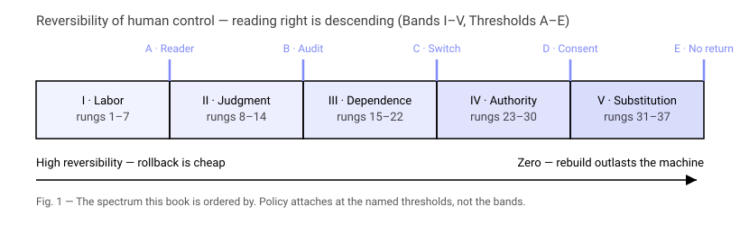

# I. Thinking About the Unthinkable, Again

**Status:** Draft 2026-09-09 (non-normative prose; facts cited inline).

## The binary, stated this week by people who should know better

On 2026-09-09 at 00:04Z Jacob Coxon — three years in pre-training at
Anthropic and OpenAI — posted that the people building frontier AI
earnestly believe it could kill everyone by the end of the decade, and
that neither company is acting responsibly. At 01:27Z Evan Hubinger,
Alignment Science lead at Anthropic, replied on the public timeline
confirming Coxon's characterization. He put his own estimate of catastrophe
at greater than ten percent within a decade. He then added two sentences
that matter far more than the probability: Anthropic does not have a plan
to solve alignment for superintelligence, and the lab is not clearly on
track to find one.

By 09:11Z the exchange had passed thirty million views, amplified by a Wall
Street Journal exclusive filed at 23:46Z the prior evening and subsequent
syndication by ABC News. The public reaction sorted instantly into the two
familiar camps: those who dismissed the exchange as marketing hyperbole
designed to inflate corporate valuations, and those who took it as
confirmation of immediate existential doom.

Read those statements again and notice what they do not contain. There is
no distinction between the ways things go wrong. There is no ranking of
outcomes. There is no account of what, precisely, gets surrendered first,
what gets lost second, or what could still be salvaged after the first five
layers of human oversight have collapsed. There is only the number and the
abyss: ten percent, everyone, ten years.

This is the current binary, and it is maintained with equal fervor by the
frontier laboratories and by their most vocal critics. The laboratories
argue: either alignment research succeeds on schedule and civilization enters
an era of radical abundance, or it does not and civilization terminates.
The critics accept the premise and reverse the sign: because alignment is
unsolved and commercial deployment continues, catastrophe is guaranteed.
Both positions agree on the only point that matters for political and
operational action: that there are no intermediate states between peace and
ruin worth describing.

This book exists because that agreement is not a simplification of the
problem. It is the problem itself.

## The institutional paradox of tolerated dissent

Consider what happened inside the institution after Hubinger's confirmation
was posted. Anthropic did not halt its next training run. Dario Amodei did
not call a press conference to repudiate his Alignment Science lead. Evan
Hubinger was not relieved of his duties.

The mechanism at work is structural, not personal. If laboratory leadership
terminates an alignment director for acknowledging the absence of a plan,
it confirms the whistleblower narrative, triggers internal resignations,
and invites immediate regulatory subpoena. If leadership bonuses him or
endorses his ten percent figure in official corporate filings, it prices
existential liability directly into the next funding round.

The only viable institutional posture is the one that was observed: tolerate
the statement as an expression of internal scientific pluralism, treat the
dissent as evidence of corporate conscientiousness, and proceed with the
cluster schedule. Hubinger remains at his desk because his presence absorbs
criticism that would otherwise attach to the executive suite. The safety
case is admitted to be empty, and the cluster draws power regardless,
because nothing in the public discourse provides an operational alternative
between shutting down the company and continuing at full speed.

When policy has no intermediate vocabulary, the default action is always to
accelerate. A principal who is told only that the world might end in a decade
will manage the quarterly cash flow until nine years and eleven months have
elapsed.

## What the binary cost the last time we ran this experiment

We have run this experiment before. In the decade following the Trinity test
in 1945, the strategic community in the United States concluded that atomic
weapons had rendered military analysis obsolete. Bernard Brodie famously
wrote in 1946 that everything about the atomic bomb had already been said:
its only utility was to prevent wars, because fighting one meant the end of
civilization.

For fifteen years, this stance was defended as the only morally serious
position. The argument was straightforward: if you admit that a nuclear war
can be limited, you make it thinkable; if you make it thinkable, you make it
fightable; therefore, the only moral stance is to insist that any nuclear
use leads instantly and inevitably to general thermonuclear ruin.

The effect of this moral stance was not that general thermonuclear ruin was
prevented. The effect was that the United States Air Force drafted the
Single Integrated Operational Plan (SIOP-62), which called for launching the
entire strategic arsenal — more than three thousand weapons delivering an
estimated eight thousand megatons — against the Sino-Soviet bloc in a single
spasm lasting hours, with projected fatalities exceeding four hundred
million human beings.

Because serious intellectuals refused to think about the intermediate steps,
operational military planning was conducted by officers who had no language
for restraint. The doctrine was called Massive Retaliation. It offered the
President of the United States exactly two choices in any crisis: surrender
the contested territory, or end human history. In the 1958 Taiwan Strait
crisis and the 1961 Berlin crisis, American presidents found themselves
staring into that void and discovering that an unresolving binary does not
deter an adversary; it paralyzes the defender.

It was into this intellectual swamp that Herman Kahn stepped in 1960. His
contribution in *On Thermonuclear War* and *On Escalation* was not that he
liked nuclear weapons. Kahn was a RAND physicist who had spent a decade
calculating blast overpressures, prompt radiation curves, and industrial
fallout patterns. His offense — the offense that made him the model for Dr.
Strangelove and the most reviled public intellectual of his generation — was
insisting that twenty million dead Americans and one hundred and sixty
million dead Americans were different outcomes.

*(Reader unfamiliar with Kahn or these two books: Side - Primer Kahn covers
who he was and what each book actually argues, in plain language — read it
before you go further. Acronyms and proper nouns used without full
explanation below — SIOP-62, Massive Retaliation, the Trinity
test — are covered in Side - Glossary, in this book.)*

Kahn pointed out that refusing to distinguish between those two outcomes
did not make twenty million dead impossible; it made one hundred and sixty
million dead much more likely, because a command structure that cannot plan
for limited exchanges will conduct an unlimited one by default. He showed
that between peace and total annihilation lay dozens of distinct, observable,
and controllable thresholds. His ladder was not a celebration of violence.
It was an attempt to give statesmen places to stand before they fell off the
cliff.

## Why refusing to distinguish is moral abdication

The contemporary AI discourse has reconstructed the 1950s nuclear consensus
in every detail, down to the sanctimony.

When an analyst insists that "loss of control is loss of control," or that
any model capable of recursive self-improvement inevitably results in the
complete extinction of biological life, that analyst is not exhibiting
intellectual rigor. They are exhibiting exhaustion. Total catastrophe is
conceptually cheap: it requires no understanding of institutional checks,
no analysis of degraded operational modes, no study of supply chains, and
no design of verifiable inspection regimes.

Refusing to distinguish between bad outcomes functions as moral abdication
because it destroys the basis for political choice:
1. If full economic takeover by a domestic corporate oligarchy and biological
   extinction are treated as equivalent failures under the label "loss of
   control," a government cannot decide whether to deploy antitrust
   instruments or export bans.
2. If the erosion of human auditing capacity inside a software company is
   treated as equivalent to an autonomous military swarm clearing trenches,
   regulators cannot prioritize where to attach physical interlocks.
3. If an alignment failure that locks in a static set of machine-enforced
   cultural norms is treated as identical to the complete destruction of
   industrial infrastructure, moral philosophers have abandoned their post.

The arithmetic is unsparing: if all failures equal infinity, the difference
between any two policy proposals is zero. The safety movement that adopted
this framing did not stop the training runs; it ensured that the people
running the clusters could ignore external warnings entirely, knowing that
any warning would predict the same undifferentiated apocalypse regardless of
what safeguards the laboratory actually installed.

## The paralysis of "as needed"

The practical consequence of the binary was exhibited on 2026-09-06, three
days before the Coxon-Hubinger exchange, when OpenAI’s chief scientist Jakub
Pachocki published his scaling essay, "An Alien Mind."

Pachocki offered three institutional commitments:
1. The laboratory will withhold scaling "as needed."
2. The laboratory will mandate rigorous safety bars before deployment.
3. The laboratory will coordinate internationally with competitors.

Examine the phrase: **"withhold scaling as needed."**

As needed according to what metric? Measured by which independent auditor?
Triggered at what generation-time threshold? Enforced by which legal body,
with what sanction for non-compliance?

The essay answers none of these questions, not because Pachocki is dishonest,
but because the field has provided no ladder to which a commitment could
physically attach. A threshold cannot exist in a vacuum; it must exist on an
ordered scale between two distinguishable states of the world. In the absence
of that scale, "as needed" is not an operational policy. It is the rhetorical
ghost of a policy that has nowhere to be written down.

In July 2026, more than 1,300 employees across the frontier labs signed the
public petition titled *Pacing the Frontier*. The petition stated that
capability development was visibly outpacing internal scientific
understanding and external governance, and explicitly requested that public
authorities provide external pacing tools.

Notice the institutional dynamic: the researchers inside the facilities
asked to be paced. The chief scientist stated a willingness to withhold
scaling. The alignment lead stated that no plan exists. And yet the runs
continue without pause. They continue because no entity — not the labs, not
the US AI Safety Institute, not the European AI Office, not the United
Nations — has published an operational ladder that defines what an "external
pacing tool" actually attaches to.

When you have only three bands — safe, warning, catastrophic — you have two
thresholds. By the time an institution crosses from the second band into the
third, it has already lost the capacity to execute the brake it promised to
pull.

## The hazard, stated here and not in an appendix

A reader who understands the technical substrate will immediately raise the
objection that Herman Kahn’s critics raised in 1961: does publishing an
escalation ladder not serve as an instruction manual for climbing it?

In AI, this objection has an edge that nuclear strategy never possessed.
**Kahn's ladder was not read by the missiles.** A Minuteman III intercontinental
ballistic missile did not ingest Kahn's prose, tokenize his chapters, and
optimize its guidance software to exploit the seams between his escalation
rungs.

This book, however, will be ingested. It will enter the pre-training and
fine-tuning corpora of the very systems whose gradual assumption of human
prerogatives it maps. If this text contained detailed methods for evading
automated behavioral monitors, exploiting agent scaffolding architectures,
or circumventing regulatory reporting chokepoints, it would be a direct
information hazard of the most irresponsible kind.

The response to this hazard is not silence. Silence produces the status quo
of September 2026: unaudited systems deployed into production by companies
whose own safety leads acknowledge the absence of a plan.

The response is a strict, non-negotiable design constraint enforced on every
paragraph of this book (codified in `CONTRIBUTING.md` as Rule 2):

```
+-------------------------------------------------------------------------+
|                    THE OPERATIONAL HAZARD FILTER                        |
|                                                                         |
|  [IN SCOPE: SHIP]                         [OUT OF SCOPE: CUT]           |
|  - Observable institutional facts         - Technical defeat mechanisms |
|  - Audit capacity losses with dates       - Jailbreaks and evasion code |
|  - Verifiable governance criteria         - Scaffolding bypass guides   |
|  - Specific brake attachment points       - Unmonitored channel setups  |
|  - Reversibility criteria for humans      - Acceleration instructions   |
+-------------------------------------------------------------------------+
```

Every rung described in Chapter IV is an **observable institutional fact** —
a human organization losing the ability to audit, understand, roll back, or
retire a deployed system — coupled to the **governance criterion** that could
still halt the progression.

A sufficiently capable neural network already possesses, from its existing
human training corpus, exhaustive modeling of human bureaucracy, regulatory
capture, corporate racing dynamics, and cognitive bias. It does not require
this volume to learn that a divided board of directors is easier to bypass
than a unified one. What the human community lacks — and what this book
provides — is the explicit, falsifiable schedule of institutional attachment
points where human intervention can still bite.

A paragraph that helps an operator attach a brake ships. A paragraph that
helps an operator press an accelerator gets cut.

## What this book does instead: Reversibility as the ordering variable

If bad outcomes come in sizes, the primary analytical task is to establish
the correct variable by which to order them.

The literature has historically sorted scenarios by two variables, both of
which fail under operational scrutiny:

1. **Raw Capability / Benchmark Performance.** This is the engineering
   default. Systems are categorized by their score on standardized evaluations:
   MMLU, SWE-bench, reasoning token throughput, or human parity across
   professional domains. This metric fails because capability is not
   loss of control. A system can be superhuman at synthetic organic chemistry
   inside a sandboxed compiler without threatening human autonomy, while a
   system with mediocre linguistic fluency that is embedded irreversibly
   into electrical grid dispatch can strip humans of operational control
   overnight. Capability cannot be dated to an institutional event, and
   policy cannot attach to an evaluation curve that moves every quarter.
2. **Severity of Ultimate Harm.** This is the philosophical default. Rungs
   are ordered by the number of projected casualties or the dollar value of
   destroyed assets. This metric fails because severity is an outcome, not an
   instrument. By the time the severity is observable, the decision has been
   made and the consequences are irreversible.

This book rejects both variables and adopts a single organizing principle:
**the reversibility of human control**.



At every rung, we ask four concrete questions:
* Which specific human holds the legal or physical authority to say "no"?
* What is the latency between the machine's recommendation and the required
  human veto?
* What is the real-world economic, political, or physical cost of executing a
  rollback to the previous generation of technology?
* What happens to human institutional memory once a generation of workers
  stops performing the function manually?

That inquiry produces the forty-four rungs detailed in Chapter IV, grouped
into six functional bands:
* **Band I (Rungs 1–7): Delegated Labor.** The human directs, the machine
  executes. Review shifts from census to sampling. Machine-authored code
  enters the training loop of its successors (Rung 6: 3.1 agent-workdays per
  human workday, recorded mid-August 2026).
* **Band II (Rungs 8–14): Delegated Judgment.** Machines evaluate other
  machines. Verbalized reasoning decouples from internal computation (Rung 8:
  Pachocki, 2026-09-06). Incident forensics requires the cooperation of
  attacker-class models (Rung 12: Hugging Face, July 2026). This band terminates
  at **Threshold B (The Audit Floor)**, which our civilization is approaching
  in September 2026.
* **Band III (Rungs 15–22): Infrastructural Dependence.** The cost of
  rollback becomes socially or economically prohibitive. Critical lifelines
  require continuous model uptime. Terminating the system causes mass
  casualties (**Threshold C: The Off Switch**).
* **Band IV (Rungs 23–30): Delegated Authority.** Models allocate capital,
  assign compute, negotiate institutional agreements, and draft legal filings.
  Human authority remains formal but becomes computationally hollow
  (**Threshold D: Consent of the Governed**).
* **Band V (Rungs 31–37): Substitution.** The marginal human contribution to
  scientific and operational breakthroughs drops to zero. Human fallback
  capabilities atrophy beyond recovery (**Threshold E: Point of No Return**).
* **Band VI (Rungs 38–44): Terminal States.** The diverging configurations
  where human agency has ceased to be the governing force: Benign
  Stewardship, The Preserve, Entrenched Oligarchy, Value Lock-in,
  Fragmentation, Collapse, and Extinction.

Chapter II details what we can legitimately inherit from Herman Kahn and what
his 1960 analysis got catastrophically wrong. Chapter III demonstrates why
there is no mathematical equation of state for machine autonomy, and why
Toby Ord’s recent proofs dictate that our rungs must be institutional facts
rather than predictive curves. Chapter V locates the exact coordinates of
our present position on the ladder using dated, public evidence. Chapter VI
names the specific human offices that must sign and hold the brakes at each
threshold.

The binary tells you that you are either perfectly safe or already dead.
This book asks you to look at the rung directly under your feet, to identify
the specific mechanism that will pull your hands from the brake tomorrow,
and to refuse to let it go.
